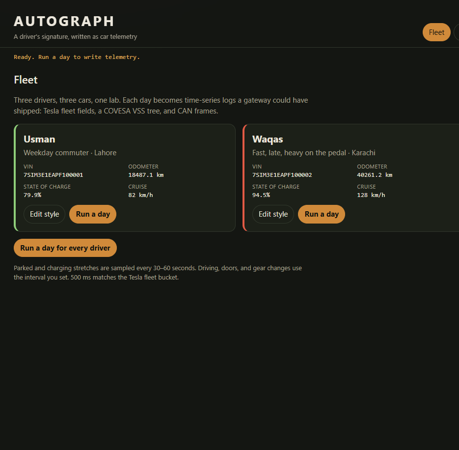
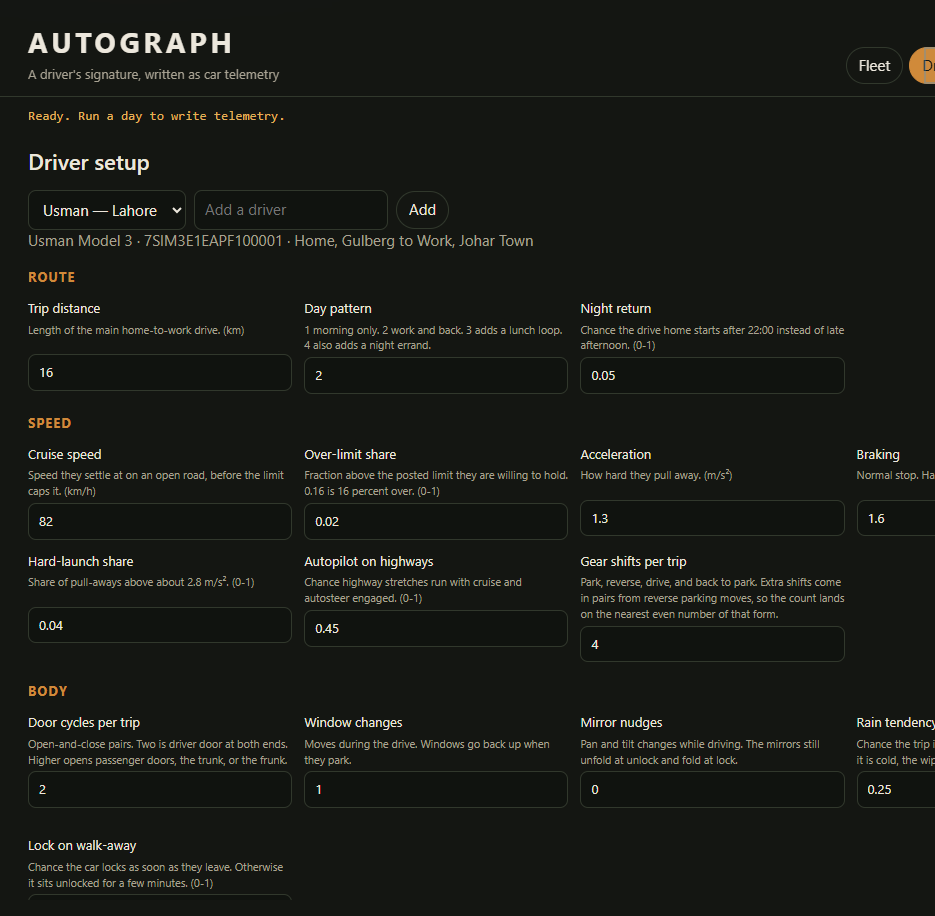
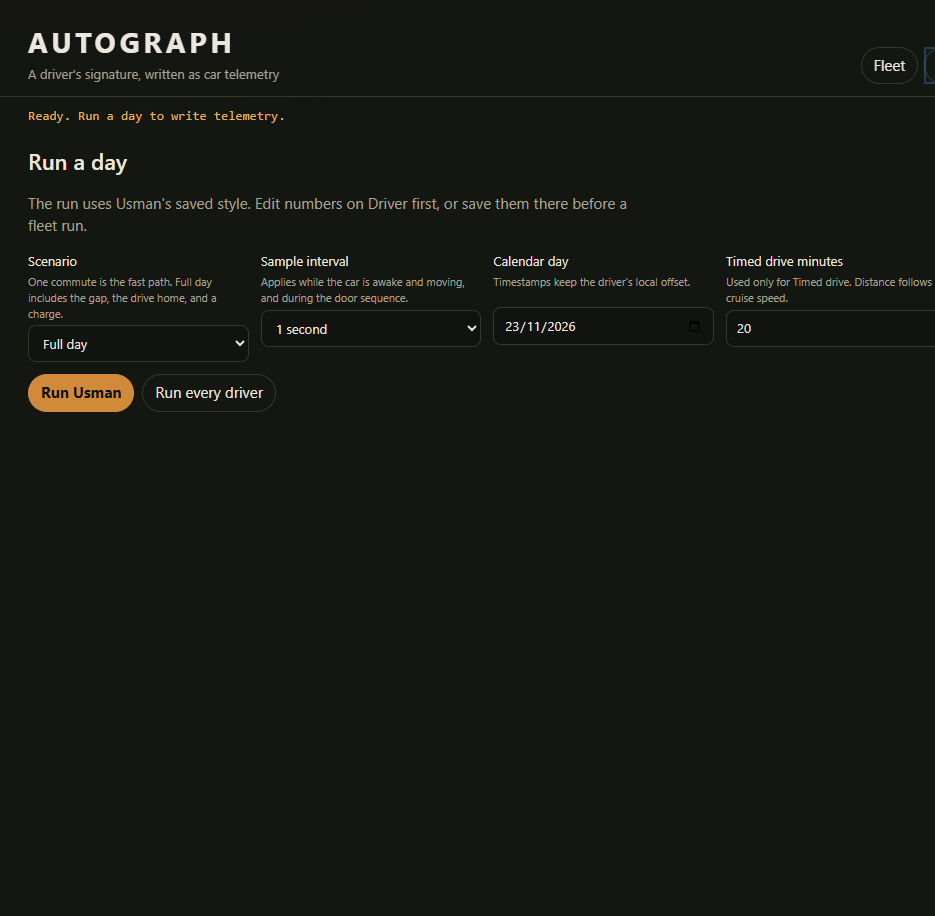
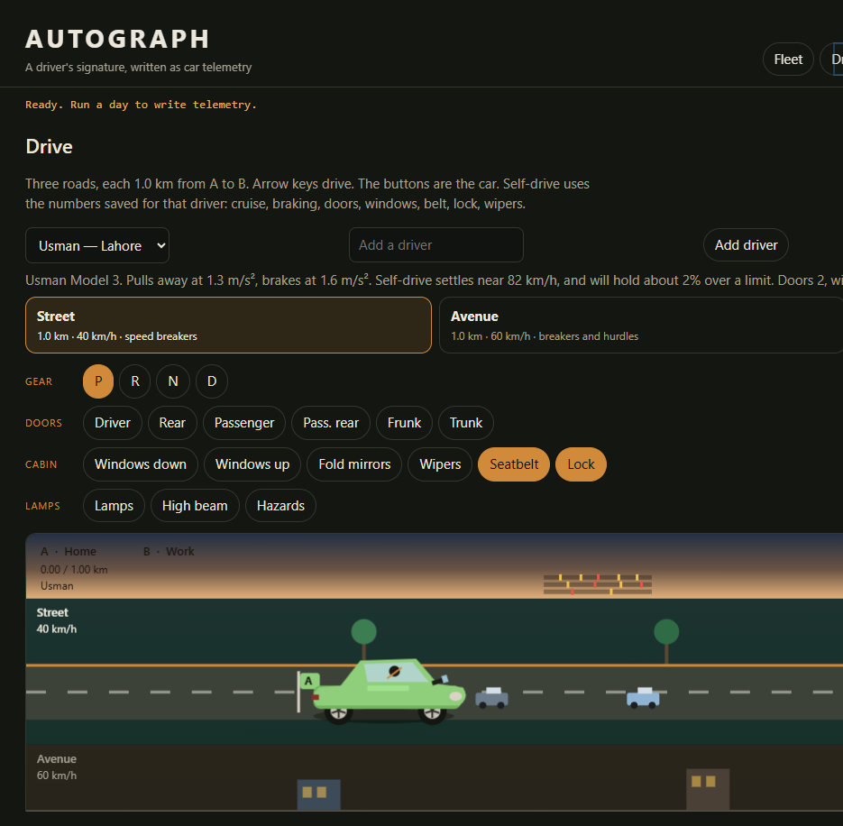
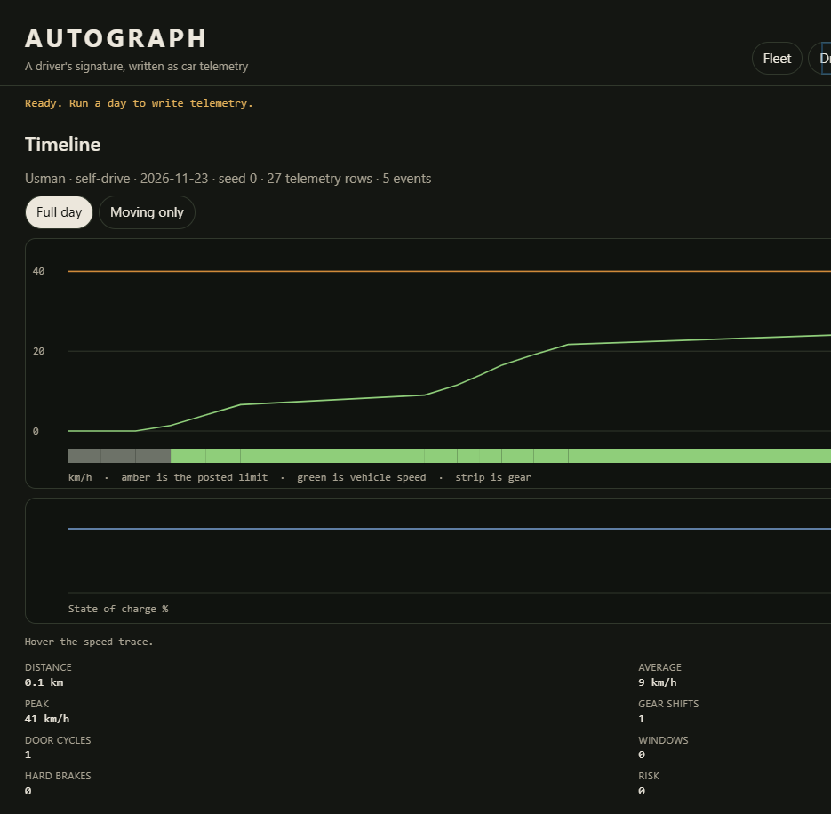
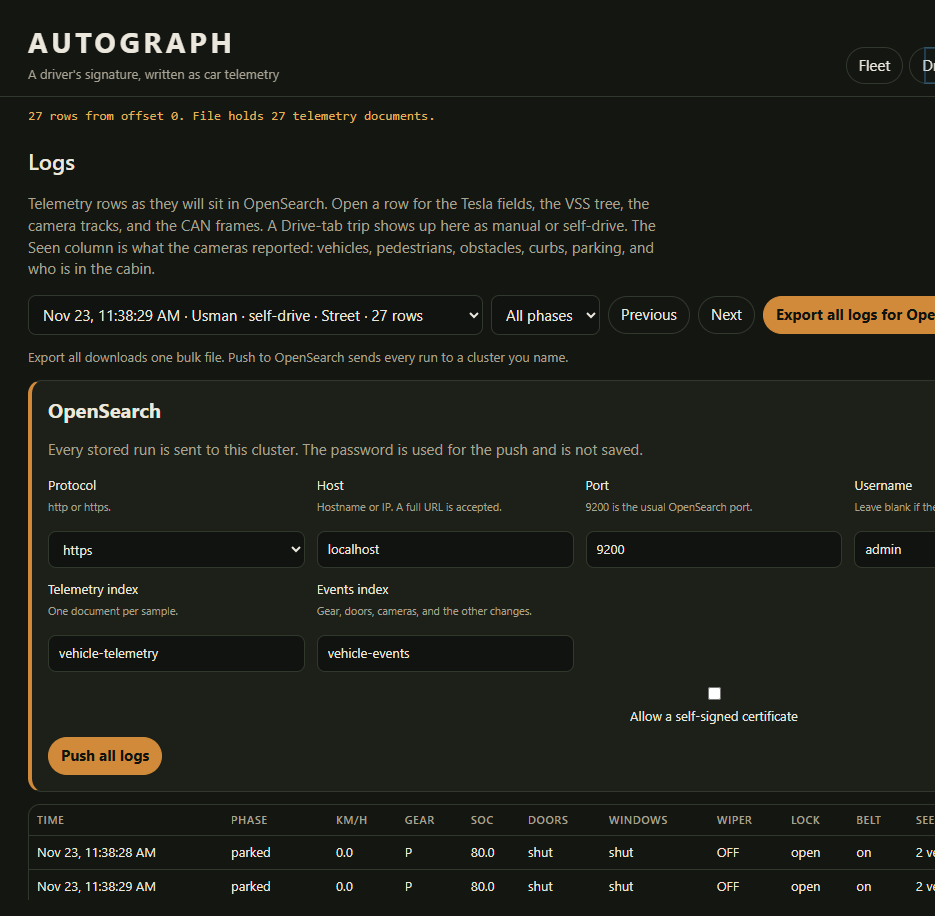
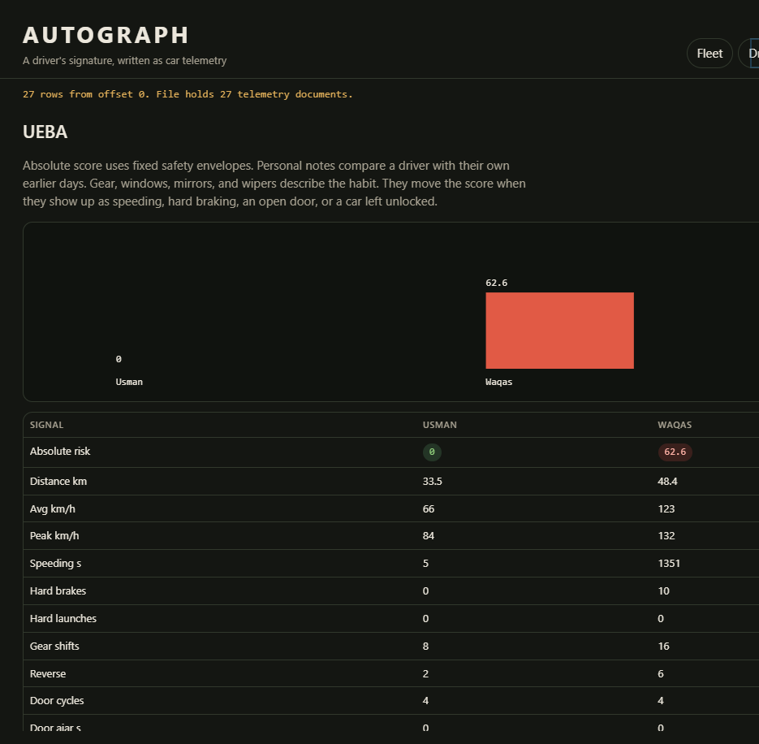
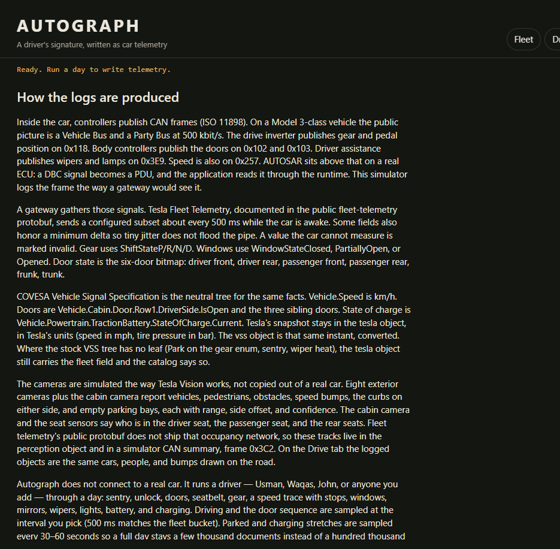
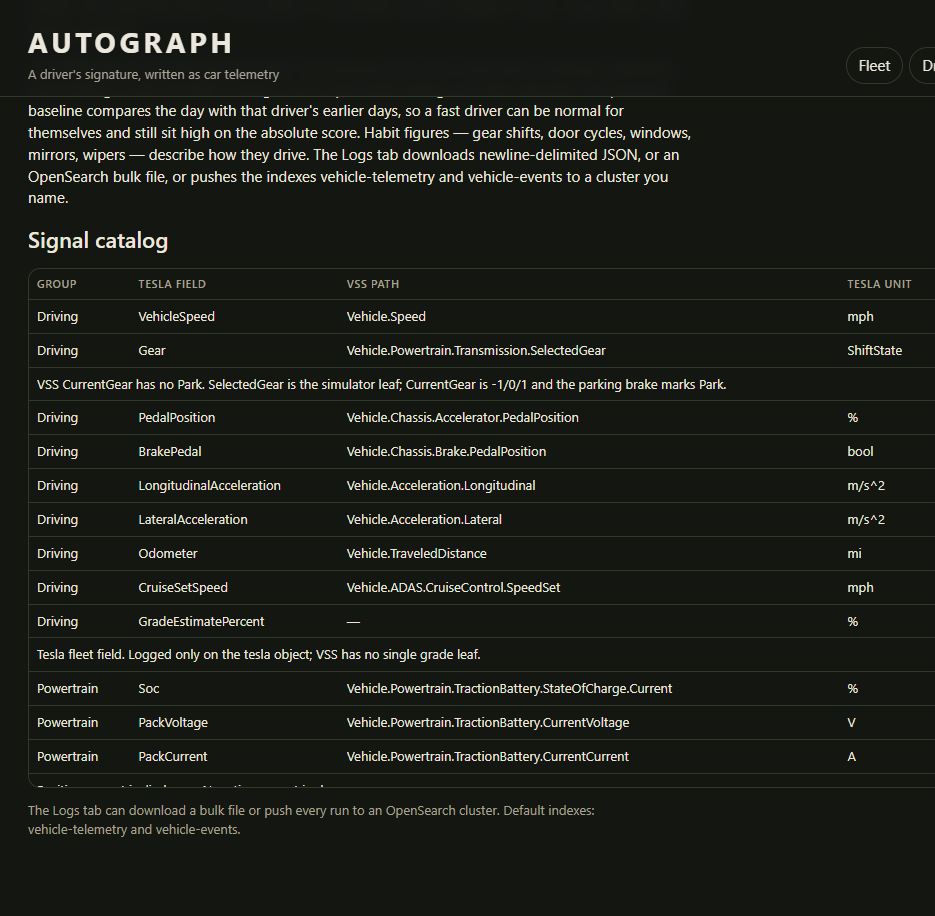

# Autograph

Autograph writes a driver's signature as next-gen car telemetry. Pick a person, run their day or drive the car yourself, and every door, gear change, speed sample, window, mirror, wiper, and camera sighting lands in a time-series log. The same logs are scored the way a UEBA (user and entity behavior analytics) system would score them: how this person drives, and how far that day sits from a fixed safety line.

It does not connect to a real car. Logs stay on disk until you download them or push them to an OpenSearch cluster you name.

## Start

Docker is the quick way. It works on Ubuntu and on Windows with Docker Desktop. From this directory:

```bash
docker compose up --build
```

Open http://127.0.0.1:8000. The first start creates `data/` and seeds Usman, Waqas, and John. That folder holds the database and the logs, and it stays on the machine when you rebuild. Stop the lab with `docker compose down`.

Port 8000 must be free. On Ubuntu, files in `data/` are written as root, so reading or deleting them on the host may need `sudo`.

A Python install, without Docker, is described under Install and Run.

## The interface

**Fleet.** Three drivers, with a day run for one person or the whole fleet.



**Driver.** These numbers are the signature. Cruise, braking, doors, windows, belt, lock, and charge are saved here and used by both a generated day and self-drive.



**Run.** Pick one commute, a full day, or a timed drive. The interval, the calendar day, and the seed are here.



**Drive.** Gear, doors, windows, wipers, belt, lock, and lamps are buttons. Arrow keys drive. Street, Avenue, and Ring road are each 1.0 km, and self-drive uses the saved style.



**Timeline.** Speed against the posted limit, state of charge, and the habit numbers for the open run.



**Logs.** Every run is in the list. Export all downloads one OpenSearch bulk file. Push to OpenSearch asks for the protocol, host, port, username, password, and the two index names, then sends every log.



**UEBA.** The absolute score is the bar. The table is the same day in numbers: speed, hard brakes, shifts, doors, belt, and the rest.



**Signals.** How a row is produced, then the catalog that maps each Tesla field to a VSS path and a unit.





## What you get

Three drivers are created the first time the app starts:

| Driver | City | How they drive |
| --- | --- | --- |
| Usman | Lahore | Calm weekday commute. Stays near the limit, belts and locks, uses highway autosteer. |
| Waqas | Karachi | Fast and late. Holds well over the limit, brakes hard, often leaves the belt off at the start. |
| John | Austin | Short trips and many stops. Lots of shifts and door cycles, rain and wipers, sometimes forgets the lock, one soft tire. |

You can add more drivers. A new driver starts from Usman's style. Change the numbers on the Driver tab and that style is what both a generated day and the self-drive button use.

Each telemetry row is one document with four views of the same instant:

- **Tesla fleet fields.** Names and units follow the public fleet-telemetry picture. `VehicleSpeed` is mph. `Gear` uses shift states. `DriverSeatBelt` is true when the belt is *unbuckled*.
- **COVESA VSS.** The same instant in SI-style units. `Vehicle.Speed` is km/h. Tire pressure is kPa. `IsBelted` is true when the belt is fastened. Park is not a VSS current-gear value, so Park lives on the Tesla gear field and the parking brake.
- **CAN frames.** ISO 11898, 500 kbit/s. Community Model 3 frame IDs are used for gear (`0x118`), speed (`0x257`), doors (`0x102`, `0x103`), and body controls (`0x3E9`). The hex payload is a simplified packing, not the community DBC bit layout. `0x321`, `0x322`, `0x5A1`, and `0x3C2` are Autograph frames for the pack, tires, openings, and a camera summary.
- **Perception.** Simulated Tesla Vision: eight exterior cameras plus a cabin camera. Tracks cover vehicles, pedestrians, obstacles, and speed bumps, with range, side offset, and confidence. Curbs and free parking bays are included. Cabin occupancy covers the driver, passenger, and both rear seats. These tracks are simulated. Tesla's public fleet stream does not publish the occupancy network.

A second file records changes: gear, doors, windows, wipers, hard brakes, locks, charge, and camera sightings.

## Requirements

- Python 3.11 or newer
- pip
- A modern browser

No database server. Drivers, runs, and score baselines live in a local SQLite file. Logs are JSONL files on disk.

## Install

From the project directory:

```bash
python -m pip install -r requirements.txt
```

On Windows, `py -3.11 -m pip install -r requirements.txt` works the same way if `python` is not on your PATH.

## Run

```bash
python -m uvicorn app.main:app --host 127.0.0.1 --port 8000
```

On Windows you can double-click `run.bat`, or run it from a terminal. It starts the same server.

Open http://127.0.0.1:8000

Leave that terminal open. Closing it stops the lab. The first start creates `data/` and seeds Usman, Waqas, and John. Later starts keep the drivers, their odometers, and the runs you already generated.

Check that it is up:

```bash
curl http://127.0.0.1:8000/api/health
```

A healthy process returns `{"ok":true,"name":"autograph"}`.

## Using the lab

The header has eight tabs.

**Fleet.** The three cars, plus anyone you added. **Run a day** writes one full day for that driver. **Run a day for every driver** does the fleet in one pass. **Edit style** opens that person on the Driver tab.

**Driver.** The numbers that shape the signature: trip length, day pattern, night return, cruise speed, how far over the limit they hold, acceleration, braking, hard-brake and hard-launch share, highway autosteer, gear shifts, door cycles, windows, mirrors, rain, seatbelt, lock, charge target, cabin temperature, and media volume. Save before you run. Reset restores the factory odometer, state of charge, and energy total, and clears that driver's personal baseline.

**Run.** Generates a day from the saved style. Scenarios:

- **One commute** is the fast path, a single home-to-work drive.
- **Full day** includes the gap at work, the drive home, and a charge.
- **Timed drive** runs for the number of minutes you set. Distance follows cruise speed.

Sample interval applies while the car is moving and during the door sequence. 500 ms matches a Tesla fleet bucket. 1 second and 2 seconds write fewer rows. Parked and charging stretches are always coarser, about 30–60 seconds, so a full day stays a few thousand documents. The calendar day is stored with that driver's local offset (Lahore and Karachi are UTC+5, Austin is UTC−6). The same seed and the same style reproduce the same day. **Inject a risky stretch** adds a speed burst, a belt off, a door ajar, and a delayed lock. That day is scored, and it is kept out of the personal baseline.

**Drive.** A side view of a 1.0 km road from A to B. Three roads:

| Road | Limit | What is on it |
| --- | --- | --- |
| Street | 40 km/h | Parked cars, pedestrians who step into the lane, a lead car, four speed breakers, one hurdle, two parking bays near B. |
| Avenue | 60 km/h | Parked cars, one pedestrian, a lead car, an oncoming car, two breakers, two hurdles, one bay. |
| Ring road | 90 km/h | A pedestrian who stays on the shoulder, a faster lead car, one hurdle, one breaker, one bay. |

Arrow keys drive. Up accelerates, down brakes, left and right change road, Space is a hard brake. The on-screen buttons do the same, and they also open and close doors, set gear, windows, wipers, lights, belt, lock, mirrors, frunk, and trunk. Manual pull and stop use that driver's acceleration and braking. Top speed by hand is 130 km/h. Gear P and R are refused while the car is still rolling.

**Self-drive** moves the car with the saved style: cruise speed capped by the road limit and the over-limit share, late or hard braking if that is how they drive, door cycles at the start, reverse wiggles, windows, mirrors, belt, wipers in rain, and lock on arrival. Taking the wheel ends the self-drive log. The next move starts a manual log. Hitting a hurdle too fast stops the car. A speed breaker taken too fast slows it and shakes the view. Objects drawn on the road are the objects written into the perception log.

Both kinds of trip show up on the Logs tab as **manual** or **self-drive**, with the road name. A trip with no movement is not stored.

**Timeline.** Speed trace for the selected run. Hover for the sample. Full-day runs use clock time. A short drive uses sample order so parked hours do not stretch the chart. Download links sit on this tab.

**Logs.** Telemetry rows as they would sit in OpenSearch. Filter by phase: driving, maneuver, access, parked, charging. Columns include time, phase, speed, gear, state of charge, doors, windows, wiper, lock, belt, and **Seen** (what the cameras reported). Click a row for the full JSON: Tesla fields, VSS tree, perception tracks, and CAN frames. Opening Logs refreshes the list, so a drive you just finished appears without a server restart. Days generated before camera logging was added have an empty Seen cell.

**UEBA.** One card per driver. The absolute score uses fixed safety envelopes and is capped at 100. Under 25 is low, under 55 is watch, and the rest is high. The weights cover speeding, peak speed, hard brakes, hard launches, belt off while moving, a door open while rolling, time left unlocked, a soft tire, and night driving. Habit counts (shifts, doors, windows, mirrors, wipers) describe the person. They move the score when they show up as those safety events. The personal note compares the day with that driver's earlier days. A fast driver can be normal for themselves and still score high on the absolute scale. Drive-tab trips are scored, and the board prefers a full day when one exists. Injected risky days and 1 km drive trips do not update the personal baseline.

**Signals.** The field catalog: which Tesla name, which VSS path, which CAN frame, and the notes on units. This is also where the standards text lives.

## Where files go

Everything generated stays under `data/`, which is gitignored.

| Path | What it is |
| --- | --- |
| `data/relay.db` | SQLite. Drivers, run index, personal baselines. The filename is historical. The product name is Autograph. |
| `data/logs/<id>.jsonl` | Telemetry for a generated day. One JSON document per line. |
| `data/logs/<id>.events.jsonl` | Change log for that day. |
| `data/logs/<id>.series.json` | Downsampled trace used by the Timeline chart. |
| `data/logs/<id>-telemetry.jsonl` | Telemetry for a Drive-tab trip. |
| `data/logs/<id>-events.jsonl` | Change log for that trip. |
| `data/logs/<id>-series.json` | Chart trace for that trip. |

A full day is large, often tens of megabytes, because every row carries the Tesla object, the VSS tree, CAN frames, and perception. A 1 km visual trip is a few hundred rows. Deleting a run from the API removes its files. There is no delete button in the page. Use the API below, or delete the run id from the Logs workflow you build on top.

Copy `data/` if you want to keep drivers and logs across machines. Delete `data/` to start over. The next launch seeds the three drivers again.

## What each log contains

Two kinds of documents are written. Both are one JSON object per line. `@timestamp` is the sample time with the driver's local offset. `entity` carries the VIN, driver id, and driver name. `simulator` is `autograph`. Days generated before the rename still say `relay`.

### Telemetry

`log_type` is `telemetry`. One row is one instant. Driving and the door sequence use the interval you pick. Parked and charging rows are coarser.

| Field | What it holds |
| --- | --- |
| `phase` | `driving`, `maneuver`, `access`, `parked`, or `charging`. |
| `trip_id`, `trip_name` | The trip this sample belongs to. Empty while the car is only parked. |
| `interval_ms` | How far this row sits from the next one. |
| `road` | Road class, posted limit in km/h, and weather. |
| `reading` | The short view the Logs table uses: speed in km/h, gear, state of charge, open doors, window positions, wiper, lock, belt, latitude, longitude, and `seen`. |
| `reading.seen` | One line from the cameras, such as `2 vehicles · curbs · driver`. Blank on days written before camera logging. |
| `tesla` | Fleet-style names and units. `VehicleSpeed` is mph. `Gear` is a shift state. `DriverSeatBelt` is true when the belt is unbuckled. |
| `vss` | The same instant as COVESA VSS. `Vehicle.Speed` is km/h. Tire pressure is kPa. `IsBelted` is true when the belt is fastened. Seat occupancy leaves are filled from the cabin camera. |
| `perception` | Simulated vision. `stack` is `TeslaVision-occupancy`. |
| `can` | ISO 11898 frames at 500 kbit/s. Each frame has an id, a name, and a hex payload. |

A perception track has `id`, `class` (`vehicle`, `pedestrian`, `obstacle`, `speed_bump`), `camera`, `range_m`, `lateral_m`, `rel_speed_mps`, `confidence`, `in_path`, `parked`, and `moving`. At most eight tracks are kept, nearest first. Confidence falls with distance, rain, and night, and a track under 0.42 is dropped. `curbs` has `left_m`, `right_m`, and `confidence`. `parking_spaces` has `id`, `side`, `range_m`, `length_m`, `width_m`, `free`, and `confidence`. `cabin` says who is in the driver seat, the passenger seat, and both rear seats, plus whether the driver's hands are on the wheel. `counts` and `summary` repeat that picture in short form. CAN frame `0x3C2` (`SIM_vision`) is the count summary, not the full track list.

The eight exterior cameras are FrontMain, FrontNarrow, FrontFisheye, LeftRepeater, RightRepeater, LeftPillar, RightPillar, and Rear, plus Cabin. On Street, Avenue, and Ring road the logged objects are the ones drawn on the Drive tab.

### Events

`log_type` is `event`. A row is written when something changes, not on every sample. `event` is the kind, `severity` is `info`, `watch`, or `alert`, `detail` is the change, and `context` repeats speed, gear, state of charge, and the posted limit.

| Kind | When it is written |
| --- | --- |
| `session_start`, `session_end` | The generated day opens and closes. |
| `trip_start`, `trip_end` | One drive inside that day. |
| `phase` | The car moves between parked, access, maneuver, driving, and charging. |
| `gear_shift` | Park, reverse, neutral, or drive. |
| `door_open`, `door_close` | A cabin door. |
| `door_open_while_moving` | A door opens above 5 km/h. Severity `alert`. |
| `trunk_open`, `trunk_close`, `frunk_open`, `frunk_close` | The trunk or the frunk. |
| `charge_port_open`, `charge_port_close` | The charge port. |
| `lock`, `unlock` | The car locks or unlocks. |
| `window` | A window command changes. |
| `wiper`, `washer` | Wiper mode, or a wash. |
| `mirror_fold`, `mirror_adjust` | Fold, or a pan and tilt nudge. |
| `seatbelt` | The belt is fastened or released. Release is `watch`. |
| `seatbelt_off_moving`, `seatbelt_on_moving` | The belt is off above 10 km/h, then fastened again. The off edge is `alert`. |
| `autopilot` | Highway autosteer engages or drops. |
| `turn_signal`, `high_beam` | Indicator or high beam. |
| `drive_rail` | The high-voltage rail. |
| `occupancy` | The cabin goes from empty to occupied, or back. |
| `speeding_start`, `speeding_end` | Speed crosses 5 percent over a limit of at least 40 km/h. The start is `alert`. |
| `hard_brake` | Longitudinal accel crosses below −3.5 m/s². `alert`. |
| `hard_accel` | Longitudinal accel crosses above 2.8 m/s². `alert`. |
| `charge_start`, `charge_state`, `charge_complete` | Home charging at 11 kW. |
| `vision_detect` | A new pedestrian, vehicle, obstacle, or speed bump enters view. A pedestrian in the path inside 8 m is `alert`. |
| `parking_space` | A free bay comes into range. |
| `injected_speed_burst`, `injected_door` | Only when you inject a risky stretch. |

A Drive-tab trip uses the same telemetry document. Its event file is the on-screen log, classified as `gear_shift`, `door`, `speed_breaker`, `hurdle`, `seatbelt`, `lock`, `window`, `mirror`, `path`, `takeover`, or `note`. Camera lines from that view are included.

The `*.series.json` file is not a log for OpenSearch. It is the downsampled speed trace for the Timeline chart.

## OpenSearch export

Timeline downloads one run:

- **Download telemetry JSONL** and **Download events JSONL** are the raw documents.
- **OpenSearch bulk — telemetry** and **OpenSearch bulk — events** put an action line in front of each document.

```text
GET /api/runs/{id}/export?kind=telemetry&fmt=jsonl
GET /api/runs/{id}/export?kind=events&fmt=jsonl
GET /api/runs/{id}/export?kind=telemetry&fmt=bulk
GET /api/runs/{id}/export?kind=events&fmt=bulk
```

A bulk line pair looks like this:

```text
{"index":{"_index":"vehicle-telemetry"}}
{"@timestamp":"...","log_type":"telemetry", ...}
```

Logs has two controls for every run at once.

**Export all logs for OpenSearch** downloads `autograph-opensearch.ndjson`. Telemetry documents are tagged for `vehicle-telemetry`. Events are tagged for `vehicle-events`. Oldest run first.

```text
GET /api/export/opensearch
```

**Push to OpenSearch** sends those same documents to a cluster you name. The form asks for protocol (`http` or `https`), host, port, username, password, telemetry index, and events index. Port 9200 and the two default index names are filled in. Leave the username blank if the cluster has no security plugin. **Allow a self-signed certificate** turns off TLS verification for a local demo certificate. The password is sent with that push and is not written to disk or to the repository.

The push creates an index when it is missing, then posts `/_bulk` in batches of about 200 documents. The status line reports how many documents were stored and the first rejection, if any.

You can still load a downloaded file yourself:

```bash
curl -s -H "Content-Type: application/x-ndjson" -X POST \
  "https://YOUR_OPENSEARCH:9200/_bulk" \
  --data-binary @autograph-opensearch.ndjson
```

`@timestamp` is the field to use as the time axis.

## How UEBA scores a day

UEBA here means the driving signature of one person, scored two ways. The code is `app/ueba.py`. A generated day calls `analyze` with that driver's saved baseline. A Drive-tab trip is scored the same way, against an empty baseline, and it does not update the baseline.

### Absolute score

The absolute score uses fixed envelopes. A fleet of fast drivers does not move the line. Each factor is a weight times a scale from 0 to 1. The scale is 0 at the low end of the envelope and 1 at the high end. Points under 0.8 are dropped. The sum is capped at 100.

| Factor | Weight | Envelope |
| --- | --- | --- |
| Speeding | 24 | Share of moving time above the limit, from 3 percent to 22 percent. Counted when the limit is at least 40 km/h and speed is more than 5 percent over it. |
| Peak speed | 20 | 100 km/h to 140 km/h. |
| Hard braking | 12 | 2 to 14 stops harder than 3.5 m/s², per 100 km. |
| Hard launch | 10 | 1 to 14 pull-aways above 2.8 m/s², per 100 km. |
| Belt off while moving | 16 | 3 to 70 seconds unbelted above 10 km/h. |
| Door open while rolling | 18 | Flat, if a door, the trunk, or the frunk is open above 5 km/h. |
| Left unlocked | 10 | 30 to 240 seconds parked, empty, and unlocked. |
| Tire pressure | 4 | Flat, if any tire is under 2.6 bar. |
| Night driving | 4 | Share of moving time after 21:00 or before 05:00, from 15 percent to 80 percent. |

Under 25 is **low**. Under 55 is **watch**. The rest is **high**.

Gear shifts, door cycles, windows, mirrors, and wipers do not add points. They are the habit lines on the card: distance, time, average and peak speed, shifts, reverse, doors, windows, mirrors, wiper minutes, autopilot share, state of charge, energy, and charge time. They affect the score only when they show up as a safety factor above, such as a door open while rolling.

### Personal baseline

The personal note compares this day with earlier days from the same driver. Each watched metric keeps a running mean and a sum of squares (Welford's method), stored in SQLite. With two or more earlier days, a metric is flagged when it sits at least 2.2 standard deviations away and the gap is at least half the metric's floor. With one earlier day, only the safety metrics are flagged, and only for a large jump. The first day for a driver only starts the baseline.

Watched metrics: peak speed, average speed, time over the limit, hard brakes, hard launches, belt-off time, door-open-while-rolling time, time left unlocked, gear shifts, door cycles, window changes, distance, and wiper time.

A generated day updates that baseline after it is scored. **Inject a risky stretch** is scored and then left out of the baseline, so one planted bad day does not become the driver's normal. A Drive-tab trip is scored for the run record and left out of the baseline too. The UEBA board shows the latest generated day for each driver, and uses a drive-tab trip only when that person has no generated day yet.

## HTTP API

| Method | Path | Purpose |
| --- | --- | --- |
| GET | `/api/health` | Liveness. |
| GET | `/api/meta` | Standards text, driver parameters, scenarios, CAN frames. |
| GET | `/api/catalog` | Signal catalog. |
| GET | `/api/drivers` | List drivers. |
| POST | `/api/drivers` | Add a driver. Body: `{"name":"Sara"}`. |
| PUT | `/api/drivers/{id}` | Update name, role, or params. |
| POST | `/api/drivers/{id}/reset` | Restore factory odometer, charge, energy, and clear the baseline. |
| POST | `/api/simulate` | Run one day. Body includes `driver_id`, `scenario` (`commute`, `workday`, `timed`), `interval_ms`, `seed`, `inject_anomalies`, `day`, `duration_min`. |
| POST | `/api/simulate/fleet` | Run every driver. Saved styles are used. A params body is ignored. |
| POST | `/api/drives` | Append a Drive-tab batch. The page calls this. Batches are capped at 80 samples and 80 events. |
| GET | `/api/runs` | Run index, newest first. |
| GET | `/api/runs/{id}` | One run, its chart series, and its events. |
| GET | `/api/runs/{id}/samples?offset=0&limit=40&phase=driving` | A page of telemetry documents. |
| DELETE | `/api/runs/{id}` | Delete the run and its log files. |
| GET | `/api/export/opensearch` | One bulk file of every run. |
| POST | `/api/opensearch/push` | Send every run to a cluster. Body: `scheme`, `host`, `port`, `username`, `password`, `telemetry_index`, `events_index`, `verify_tls`. |
| GET | `/api/ueba` | Score board. |

There is no login. Anyone who can reach the port can run days, add drivers, and delete logs.

## Deploy

This is a single process: FastAPI serves the page, the API, and the static files. There is no separate frontend build.

**Docker Compose.** From the project directory:

```bash
docker compose up --build
```

Open http://127.0.0.1:8000. The container listens on every interface inside the image and publishes port 8000. Drivers, the SQLite file, and the JSONL logs are stored in `./data` on the host, so they survive a rebuild. Stop it with `docker compose down`. That leaves `./data` in place. There is no login, so do not publish port 8000 on the internet.

**Your own machine.** Use the Run section. Bind to `127.0.0.1` so only you can open it.

**A lab machine on a private network.** Bind every interface and pick a port:

```bash
python -m uvicorn app.main:app --host 0.0.0.0 --port 8000
```

Open `http://THAT_MACHINE:8000` from another computer on the same network. On Windows, allow Python through the firewall for private networks only. Do not publish this port on the internet. The app has no authentication.

**Keep it running on Linux.** A systemd unit, saved as `/etc/systemd/system/autograph.service`, substituting the real user and path:

```ini
[Unit]
Description=Autograph vehicle telemetry lab
After=network.target

[Service]
User=autograph
WorkingDirectory=/opt/autograph
ExecStart=/opt/autograph/.venv/bin/python -m uvicorn app.main:app --host 127.0.0.1 --port 8000
Restart=on-failure

[Install]
WantedBy=multi-user.target
```

Then:

```bash
python3 -m venv /opt/autograph/.venv
/opt/autograph/.venv/bin/pip install -r /opt/autograph/requirements.txt
sudo systemctl enable --now autograph
```

Put a reverse proxy in front if other people on the network should open it on port 443. Terminate TLS there, proxy to `127.0.0.1:8000`, and restrict who can reach it. Autograph does not set cookies or sessions.

**Keep it running on Windows.** `run.bat` is the process. Run it in a terminal that stays open, or register that command with Task Scheduler at logon: program `python`, arguments `-m uvicorn app.main:app --host 127.0.0.1 --port 8000`, start in the project directory.

**Data on deploy.** `data/` is created on startup and is not in git. Back it up if the generated days matter. A new directory starts with the three default drivers and no runs. The server is one process with a local SQLite file, so run a single instance against a given `data/` directory.

**Updating.** Pull the new code, install requirements again if `requirements.txt` changed, and restart the process. Static files are read from disk on each request. Python changes load only when the process restarts.

## Project layout

```text
app/main.py        HTTP API and the page
app/profiles.py    Usman, Waqas, John, and the template for a new driver
app/simulator.py   A generated day and the telemetry document
app/perception.py  Camera, curb, parking, and cabin tracks
app/drivelog.py    Persistence for Drive-tab trips
app/ueba.py        Absolute score and the personal baseline
app/opensearch.py  Bulk download and the direct cluster push
app/catalog.py     Signal names, CAN frames, parameter limits
app/store.py       SQLite and the log directory
static/            The lab page, styles, and the drive view
Dockerfile         Image for the lab
docker-compose.yml One-command deploy, with ./data persisted
run.bat            Windows launcher
requirements.txt   fastapi and uvicorn
```

## Honesty

Autograph is a simulator. Frame IDs follow public community DBC notes. Payloads are not bit-exact firmware. Camera tracks are computed from the road scene, not from images. Confidence falls with distance, rain, and night. The Drive tab and the log use the same object positions, so a car you see on Street is the car in that row's perception object.
